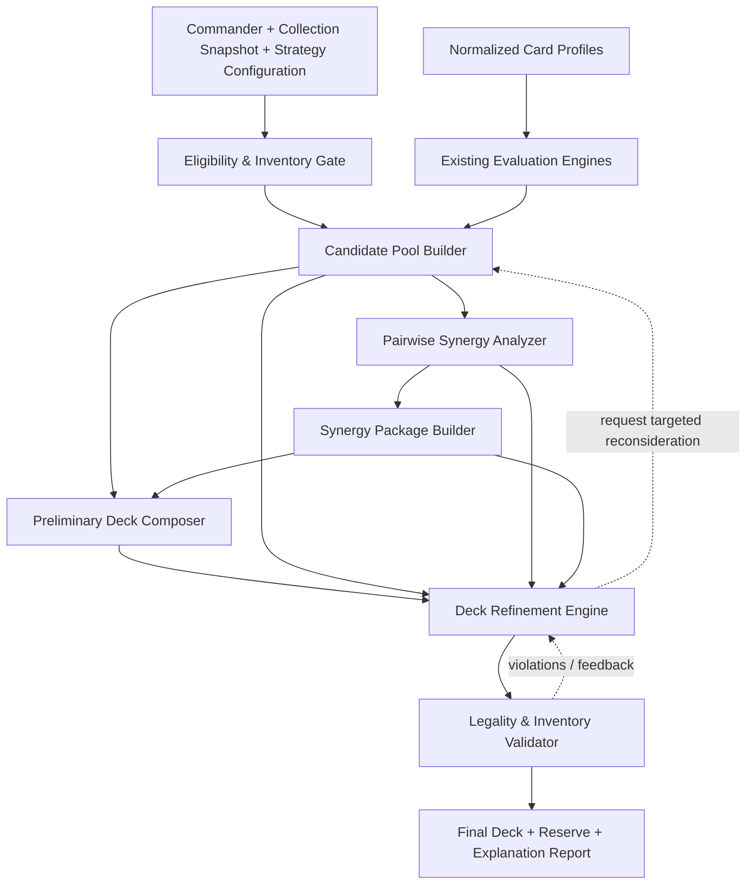

# Commander Deck Building Pipeline — Architecture

**Status:** Proposed architecture · **Version:** 1.0 · **Scope:** Owned-collection Commander deck construction

## 1. Purpose

Replace the monolithic “select 99 cards immediately” workflow with an auditable, staged pipeline that discovers a broad candidate pool, analyzes interactions and functional packages, composes a legal preliminary deck, and refines it iteratively.

This document is the **cross-component architectural contract**, not a substitute for the individual implementation guides. Existing Ramp, Card Advantage, Spot/Mass Interaction, and Strategy Synergy engines remain authoritative for individual-card evaluations.

## 2. Architectural principles

1. **Owned cards only.** Never silently add cards not in the collection snapshot. Respect quantities and card identity/printing mapping.
2. **Commander legality is a hard constraint.** Check color identity, format legality, singleton restrictions and exceptions, deck size, commander configuration, and inventory counts at finalization. Apply cheap eligibility checks before candidate discovery.
3. **Separation of concerns.** Evaluation describes cards; discovery preserves options; synergy analysis describes interactions; composition selects; refinement optimizes.
4. **Non-exclusive roles.** A card can serve Ramp, Card Advantage, Interaction, and multiple strategy roles. Store a unique card identity with multiple role memberships.
5. **Determinism and explainability.** Given identical collection, commander, rule versions, engine outputs, and configuration, produce identical outputs and traceable selection reasons.
6. **No double counting.** Shared mechanics and benefits must not be added repeatedly because they support multiple strategies or roles.
7. **Preserve alternatives.** Rejected candidates remain traceable in a reserve with reasons; do not destroy upstream results.
8. **Extensible strategy catalog.** Do not hard-code the current 15 EDHREC-inspired themes into orchestration logic.
9. **Versioned contracts and immutable snapshots.** Intermediate artifacts can be cached, compared, and replayed.
10. **No deck-dependent assumptions upstream.** Candidate scoring does not assume an existing deck. Deck-context scoring begins at composition/refinement.

## 3. System boundaries

### Inputs
- Commander identity and any partner/background or other valid commander configuration.
- Selected strategy IDs and optional weights/preferences.
- Immutable owned-collection snapshot with inventory quantities.
- Normalized Oracle/card metadata, legalities, color identities, mana values, types, and existing mechanical capability profiles.
- Outputs of four existing engines: Ramp, Card Advantage, Spot/Mass Interaction, Strategy Synergy.
- Configurable pipeline thresholds, budgets, diversity policies, scoring weights, and ruleset versions.

### Outputs
- Candidate pool (not capped at 99), role memberships, diversity diagnostics, provenance.
- Pairwise synergy edges with mechanical evidence, prerequisites, limitations, and confidence.
- Synergy packages with membership, functional roles, requirements, and bounded/repeatable flags.
- Legal preliminary deck proposal with reserves and explanations.
- Refined deck proposal, validation report, coverage report, and decision audit trail.

## 4. Component diagram



The diagram shows primary data dependencies; a coordinator controls retries and feedback, with bounded iteration and explicit stopping criteria.

## 5. Components and responsibilities

| Component | Owns | Must not own |
|---|---|---|
| Eligibility & Inventory Gate | Candidate legality, identity, inventory feasibility | Strategy quality ranking |
| Existing Evaluation Adapters | Normalize outputs from four existing engines | Reimplement those engines |
| Candidate Pool Builder | Broad recall by role, quality floor, subtype diversity, reasoned inclusion, reserve | Final 99-card selection, full-deck curve optimization |
| Pairwise Synergy Analyzer | Validated directed interactions between two cards; evidence and prerequisites | Inventing unverified combos, final card counts |
| Synergy Package Builder | Functional multi-card groups, dependency closure, resource constraints | Assuming every repeatable loop is infinite |
| Preliminary Deck Composer | Feasible first deck, role coverage, land allocation, singleton/inventory constraints | Irreversible pruning of alternatives |
| Deck Refinement Engine | Marginal contribution, coverage gaps, redundancy, curve, mana consistency, package completeness, swaps | Overriding hard legality rules |
| Validator | Format legality, deck counts, color identity, inventory, banned cards, commander configuration | Ranking cards by power |
| Pipeline Coordinator | Execution, persistence, versioning, bounded feedback, observability | Card mechanic inference |

## 6. Canonical data contracts

Define typed, versioned schemas in a shared `contracts` module. The following are **logical shapes**; implementation may use Python dataclasses/Pydantic or equivalent project-native types. Do not replace existing project models without an adapter.

### 6.1 DeckBuildingContext

```json
{
  "schema_version": "1.0",
  "run_id": "run_001",
  "commander_card_ids": ["commander_001"],
  "format": "commander",
  "strategy_preferences": [{"strategy_id": "tokens", "weight": 0.6}, {"strategy_id": "aristocrats", "weight": 0.4}],
  "collection_snapshot_id": "collection_2026_11_14",
  "ruleset_version": "commander_rules_version",
  "engine_versions": {"ramp": "v1", "card_advantage": "v1", "interaction": "v1", "strategy_synergy": "v1"},
  "config_version": "v1",
  "random_seed": 0
}
```

### 6.2 CardCandidate

```json
{
  "card_id": "oracle_card_identity",
  "owned_printing_ids": ["printing_001"],
  "available_quantity": 1,
  "roles": ["ramp", "strategy_generator"],
  "mechanical_subtypes": ["treasure_generation"],
  "evaluations": {"ramp": {"score": 72}, "strategy_synergy": {"score": 91}},
  "capabilities": ["treasure_generation"],
  "dependencies": [],
  "selection_reasons": [{"code": "role_coverage", "role": "ramp", "evidence_ids": ["e1"]}],
  "status": "candidate",
  "provenance": {"collection_snapshot_id": "collection_2026_11_14", "engine_versions": {"ramp": "v1"}}
}
```

**Identity rule:** distinguish Oracle/card identity (for singleton legality and analysis) from owned printing/physical inventory identity (for quantities and export). Preserve exceptions allowing multiple copies as format rules dictate. Never assume every card is singleton (e.g., basic lands or card-specific exceptions).

### 6.3 CandidatePool

```json
{
  "schema_version": "1.0",
  "run_id": "run_001",
  "candidates": [],
  "role_memberships": {"ramp": ["card_001"], "card_advantage": [], "spot_interaction": [], "mass_interaction": [], "strategy_synergy": [], "lands": []},
  "coverage_diagnostics": {},
  "diversity_diagnostics": {},
  "reserve": [],
  "excluded": [{"card_id": "card_x", "reason_code": "outside_color_identity"}]
}
```

`role_memberships` references candidate IDs; it does not duplicate candidate records. The sum of role memberships can exceed unique candidates.

### 6.4 PairwiseSynergyEdge

```json
{
  "edge_id": "edge_001",
  "source_card_id": "card_a",
  "target_card_id": "card_b",
  "relation": "enables",
  "source_capability": "sacrifice_outlet",
  "target_capability": "creature_death_payoff",
  "prerequisites": ["sacrificed_object_is_creature", "death_event_occurs"],
  "limitations": ["requires_sacrificeable_creature"],
  "evidence": [{"card_id": "card_a", "ability_id": "a1", "rule_id": "sacrifice_death_v1"}],
  "strength": 0.8,
  "confidence": "rule_verified",
  "directional": true
}
```

A synergy edge is not automatically symmetric; `confidence` denotes evidence quality, not an LLM probability. Every edge requires a traceable rule and Oracle/ability evidence.

### 6.5 SynergyPackage

```json
{
  "package_id": "package_001",
  "member_card_ids": ["card_a", "card_b", "card_c"],
  "functional_roles": {"generator": ["card_a"], "outlet": ["card_b"], "payoff": ["card_c"]},
  "edge_ids": ["edge_001"],
  "requirements": ["available_creature", "mana_for_recursion"],
  "repeatable": true,
  "infinite": false,
  "self_sustaining": false,
  "explanation": "Repeatable value engine; additional mana is required."
}
```

Do not mark `infinite=true` without a verified resource-neutral or resource-positive closed loop and validated timing/rules constraints.

### 6.6 DeckProposal

```json
{
  "proposal_id": "deck_001",
  "run_id": "run_001",
  "commander_card_ids": ["commander_001"],
  "main_deck": [{"card_id": "card_a", "quantity": 1}],
  "reserve_card_ids": ["card_b"],
  "selected_package_ids": [],
  "role_coverage": {},
  "mana_curve": {},
  "mana_base_diagnostics": {},
  "validation": {"is_legal": false, "violations": ["incomplete_deck"]},
  "decision_log": []
}
```

For ordinary single-commander Commander, the main deck contains 99 cards plus one commander. For valid multi-commander configurations, derive main-deck count from the format's total deck size and commander count rather than hard-coding 99. An incomplete preliminary proposal may be represented but must not be labeled final/legal.

## 7. Candidate lifecycle

- `eligible` → `candidate`: passed hard filters and admitted to discovery pool.
- `candidate` → `shortlisted`: prioritized for composition.
- `shortlisted` → `selected`: included in active deck proposal.
- `candidate|shortlisted|selected` → `reserve`: retained as a swap alternative.
- Any state → `excluded`: explicit hard invalidity or documented user decision; distinguish permanent exclusion from reversible ranking decisions.

Treat lifecycle as **per run/proposal**, not as a global property of the physical card. Preserve transition timestamp/sequence, reason code, source module, and previous state. The reserve is reversible. Never mutate the immutable source collection or engine evaluations.

## 8. Candidate Pool policy

### 8.1 Discovery goals
- High recall within owned, eligible cards.
- Flexible, configurable per-role budgets; no global 99-card cap.
- Subtype diversity without rigid quotas that conflict with commander colors or collection composition.
- Multi-role cards counted once in candidate inventory and separately in each relevant coverage view.
- Strong commander/strategy synergies can be admitted through explicit exception rules, with evidence.

### 8.2 Recommended deterministic selection sequence
1. Load immutable context and engine outputs; validate schema and versions.
2. Apply cheap legality, color identity, and collection availability filters.
3. Normalize engine scores per engine, **without assuming scores from different engines are directly comparable**.
4. Build per-role candidate rankings and mechanical subtype groups.
5. Admit candidates meeting role-specific quality floors; preserve representative alternatives across subtypes.
6. Merge memberships into unique candidate records; record reasons and diagnostics.
7. Emit candidate pool and reserve; flag coverage gaps rather than fabricating missing cards.

No deck-wide simulation, full mana-curve optimization, or 99-card constraint at this stage.

## 9. Synergy analysis and packages

### Pairwise analysis
- Consume mechanical capabilities and normalized effect constraints, not keyword overlap alone.
- Validate event type, zone movement, controller/owner, target/object types, costs, replacement effects, timing, and resource requirements.
- Detect directed relations (`enables`, `rewards`, `amplifies`, `converts`) with rule IDs.
- Include commander-to-card interactions as a distinct relation source; do not count the commander against main-deck inventory.
- Use indexed capability joins to avoid a naive all-pairs scan when the pool grows; preserve deterministic order.
- Explicitly record negative/no-match outcomes for test fixtures; do not emit speculative edges.

### Package discovery
- Build packages from compatible edges with required roles and dependency closure.
- Prevent combinatorial explosion using maximum package size, beam/search budgets, canonical member ordering, and deduplication.
- Score packages for functional completeness, reliability, resource burden, and commander alignment.
- Keep package scores distinct from member-card scores; avoid double counting shared events or payoffs.
- Distinguish one-shot, repeatable, and verified infinite interactions.

## 10. Preliminary composition

Treat composition as constrained optimization, not a sorted top-99 list.

**Hard constraints:** valid commander configuration, legal format, color identity, owned quantity, copy limits and exceptions, total deck size, and required commander inclusion.

**Soft objectives:** role coverage, strategy alignment, synergy/package completeness, mana curve, mana source/color availability, resilience, mechanical diversity, and user preferences.

A deterministic greedy-plus-repair baseline is acceptable for MVP:
1. Reserve mandatory commander configuration and feasible mana-base slots.
2. Seed critical functional coverage and high-value validated packages.
3. Add candidates by **marginal utility** given the current selection, not standalone rank alone.
4. Repair legality, role gaps, mana consistency, and inventory constraints.
5. If no legal composition is feasible, emit a diagnostic failure with unmet constraints; do not silently add unowned cards.

For set `D` and candidate `c`:

`marginal_value(c, D) = utility(D ∪ {c}) − utility(D)`

Use the exact same utility definition for add/remove/swap comparisons, and log its component contributions.

## 11. Refinement loop

Evaluate selected deck as a whole: ramp density and timing, card advantage, spot/mass answers, role overlap, synergy package support, curve, mana base, redundancy, dependency fragility, and resilience. Propose deterministic swaps against reserve; accept only if hard constraints remain satisfied and objective improves under configured tolerances. Track changes and reasons. Stop on convergence, iteration cap, or no improving legal swap. Allow targeted rediscovery from eligible collection when pool coverage is insufficient; do not widen to unowned cards.

## 12. Scoring and double-count prevention

Maintain three distinct layers:
1. **Intrinsic engine evaluations:** individual card scores, with their own scales and calibration.
2. **Interaction/package evaluations:** validated incremental effects and prerequisites.
3. **Deck-context utility:** marginal contribution, coverage saturation, redundancy, and constraints.

Use normalized features only where normalization is defined; keep raw scores for provenance. Identify shared mechanical evidence by event/effect IDs and apply deduplication when a single event supports multiple roles or strategies. Package completion bonuses should represent incremental value beyond member scores. A card's role memberships are coverage signals, not separate copies or automatically additive score bonuses.

## 13. Orchestration and persistence

- Each run is identified by immutable input snapshot IDs and versioned configs.
- Persist intermediate outputs separately: pool, edges, packages, proposals, validation, audit log.
- Support partial recomputation: changes to scoring weights need not rerun Oracle parsing; changes to capability rules invalidate affected synergy artifacts.
- Cache by stable content hash of inputs and module version; avoid relying on wall-clock state.
- Provide module-level error handling, retry policy, explicit missing-data behavior, and bounded feedback loops.
- Maintain deterministic sorting/tie-breaking (e.g., canonical card ID) and seeded randomness only if an algorithm requires it.
- A CLI/local API should support `build-pool`, `analyze-pairs`, `build-packages`, `compose`, `refine`, and `run-pipeline` operations.

## 14. Observability and explanations

At each stage record:
- Input snapshot, engine/rule/config versions and elapsed time.
- Unique candidates, per-role memberships, subtype diversity, coverage gaps.
- Number of verified pairwise edges and rejected rule matches.
- Package counts, completeness, and unsatisfied requirements.
- Proposal legality, mana base and curve diagnostics, role coverage, selected/reserve counts.
- Accepted/rejected swaps with before/after utility and constraint checks.

For every included or excluded card, emit human-readable reason codes and underlying mechanical evidence. Explanations must not claim certainty beyond validated rules.

## 15. Testing strategy

**Unit:** adapters, role merging, identity/quantity accounting, eligibility, scoring normalization, deterministic sorting, transition rules.

**Rule fixtures:** token generation + token multiplier; sacrifice outlet + death trigger; blink + ETB; graveyard exile versus death; target-player whole-graveyard mass interaction; conditional and modal abilities.

**Package fixtures:** repeatable but mana-dependent engine must not be infinite; missing enabler must not produce a complete package; duplicate edges must not inflate score.

**Integration:** all four engines → pool → edges → packages → proposal → validator, including small and sparse owned collections.

**Property tests:** never select unowned cards; never exceed quantities; never count a multi-role card twice; no final illegal deck; deterministic replay under identical inputs; commander count and total size are correct for configured format.

**Regression:** golden snapshots for representative commanders with one or multiple strategies; record expected coverage and explanations without requiring exact ranking when scoring version intentionally changes.

## 16. Proposed repository organization

Adapt paths to the existing project conventions; do **not** create a parallel application architecture if one already exists.

```text
project/
  docs/
    deck-building/
      ARCHITECTURE.md
      01-candidate-pool-builder.md
      02-pairwise-synergy-analyzer.md
      03-synergy-package-builder.md
      04-preliminary-deck-composer.md
      05-deck-refinement-engine.md
      decisions/
  src/
    deck_building/
      contracts/
      adapters/
      eligibility/
      candidate_pool/
      pairwise_synergy/
      synergy_packages/
      composition/
      refinement/
      validation/
      orchestration/
      observability/
  tests/
    deck_building/
      fixtures/
      unit/
      integration/
      regression/
```

If the codebase is not Python, retain these logical boundaries but follow its native directory structure and naming.

## 17. Implementation sequence and gates

| Phase | Deliverable | Exit gate |
|---|---|---|
| 0 | Architecture alignment, shared schemas, engine adapters, fixture harness | Existing engines remain compatible; schemas validated |
| 1 | Candidate Pool Builder | Owned-only, high-recall, multi-role, diverse pool with diagnostics; no 99-card cap |
| 2 | Pairwise Synergy Analyzer | Evidence-backed directed edges, constraints, no keyword-only false positives |
| 3 | Synergy Package Builder | Validated packages, bounded search, no unsupported infinite claims |
| 4 | Preliminary Deck Composer | Legal owned-card proposal or explicit infeasibility report |
| 5 | Deck Refinement Engine | Deterministic legal swaps, improved objective, explainable stopping |

Implement **one phase at a time**, behind stable contracts and integration tests. Prefer a working vertical slice with a small fixture collection before optimizing performance or adding UI.

## 18. Non-goals for the first milestone

- No recommendation or purchase of unowned cards.
- No unverified infinite combo discovery.
- No machine-learned scoring required.
- No full gameplay simulation or opponent metagame model.
- No large-scale solver infrastructure required for MVP.
- No UI redesign until the data contracts and pipeline are stable.

## 19. Open decisions to document as ADRs

1. Card identity mapping and handling multiple owned printings.
2. Commander format ruleset source/version and special commander configurations.
3. Score normalization and default per-role discovery budgets.
4. Threshold for a verified synergy edge and representation of conditional evidence.
5. Package maximum size and search complexity budget.
6. Composer baseline algorithm and failure-reporting contract.
7. Persistence format and local cache invalidation.

Each decision should include context, alternatives, choice, consequences, and migration strategy.

## 20. Definition of done for Phase 0

- [ ] Existing repository conventions and engine APIs inspected.
- [ ] This architecture reconciled with the actual codebase; deviations recorded.
- [ ] Shared contracts created or mapped through adapters.
- [ ] Fixture collection and commander scenario established.
- [ ] Eligibility and inventory invariants covered by tests.
- [ ] End-to-end pipeline interfaces stubbed without fake production behavior.
- [ ] Candidate Pool Builder implementation can begin without needing to invent downstream schemas.
